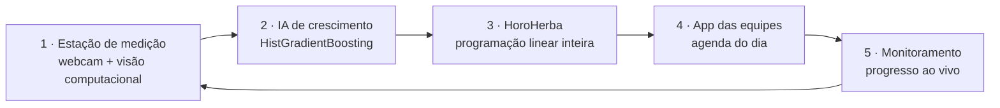

# 01 · Visão geral

## O problema

A Motiva administra rodovias como o Rodoanel Mário Covas (~180 km). A
vegetação em canteiros e taludes precisa ser podada **antes** de virar
risco: incêndio, visibilidade ruim, placas encobertas, drenagem
entupida. Hoje a decisão de *onde* e *quando* mandar uma equipe depende
de vistoria manual, planilha e intuição.

A apresentação do projeto resume o problema em quatro faltas:

| Falta | Consequência |
|---|---|
| **Captação de dados** | Ninguém sabe a altura da grama sem ir até o trecho |
| **Centralização dos processos** | Medição, planejamento e execução vivem em lugares diferentes |
| **Previsibilidade da próxima poda** | A poda acontece quando alguém percebe, não quando é necessária |
| **Alocação eficiente dos podadores** | Equipes ociosas num dia, sobrecarregadas no outro, trechos urgentes esperando |

## A solução: um ciclo fechado

| Etapa | O que faz | Onde vive |
|---|---|---|
| **Medir** | Uma câmera fixa fotografa o trecho 5 vezes, separa o verde por cor (HSV), mede a altura em cm e envia a leitura com o clima do local | Estação + API de leituras |
| **Prever** | Um modelo de *gradient boosting* aprende o crescimento semanal de cada região e simula as próximas semanas, apontando quando a altura cruza o limite de poda | IA de crescimento |
| **Otimizar** | O backend transforma cada previsão em um local com prazo, prioridade e dificuldade; um solver de programação linear inteira decide qual equipe poda qual local em qual dia | API PrognosisHerba |
| **Executar** | Cada equipe abre a agenda no celular e marca os locais concluídos | App dos podadores |
| **Acompanhar** | O painel mostra previsões, cronograma, grupos de regiões e o progresso das equipes | Painel de planejamento |

## Fluxo de uso

1. O gestor abre o **painel** e vai em *Previsões IA*: vê a altura
   prevista de cada região semana a semana, com o limiar de poda marcado.
2. Em *Otimização*, informa quantas equipes tem e roda o solver. O
   resultado é **publicado automaticamente** para as equipes.
3. Em *Cronograma*, vê a grade equipe × dia útil, com o prazo e a folga
   de cada local.
4. Cada equipe abre o **app dos podadores**, escolhe a equipe (fica
   salvo no aparelho) e vê a agenda do dia. Ao terminar um local, marca
   como concluído.
5. Em *Monitoramento*, o gestor acompanha o progresso ao vivo.
6. Em *Agrupamento*, vê quais regiões estão no mesmo estágio de
   crescimento (camada de análise, não altera o cronograma).

## Números de referência

Valores tirados dos repositórios e da apresentação. São estimativas do
protótipo, não medições de operação.

| Item | Valor |
|---|---|
| Regiões no conjunto de dados | 4 (`RA-01` a `RA-04`), ~53 leituras por região, ago/2025–ago/2026 |
| Horizonte de previsão | 52 semanas (lido do arquivo, não fixo no código) |
| Erro médio da IA fora da amostra (MAE) | 0,205 cm por semana; erro máximo 0,505 cm |
| Custo de hardware por poste | ~R$ 130 (ESP32 + câmera OV2640 + caixa + haste) |
| Densidade proposta | 1 poste a cada 500 m → 30 postes em 15 km ≈ R$ 3.900 |
| Custo de nuvem da estação e da IA | R$ 0 (planos gratuitos + Open-Meteo) |
| Testes automatizados | 355 nas três aplicações (180 API, 117 painel, 58 podadores) + ~190 na estação |

Os erros da IA foram recalculados rodando de novo a validação do
notebook `main_v3.ipynb`: 24 semanas de teste, MAE médio por região de
0,205 cm e maior erro absoluto de 0,505 cm. A apresentação arredonda
para 0,2 cm e 0,5 cm.

## O que é real e o que é simulado

| Dado | Situação |
|---|---|
| Altura e nível de alerta previstos | Reais, vêm da IA |
| Inclinação do terreno e área de risco | Fixos por região no backend (`TOPOGRAFIA_POR_REGIAO`), porque a planilha da IA ainda manda valor constante |
| Rota geográfica de cada região | **Simulada** (`ROTAS_SIMULADAS`); a tela de Agrupamento mostra um aviso |
| Feriados e folgas das equipes | Não modelados; `D` só exclui sábados e domingos |
