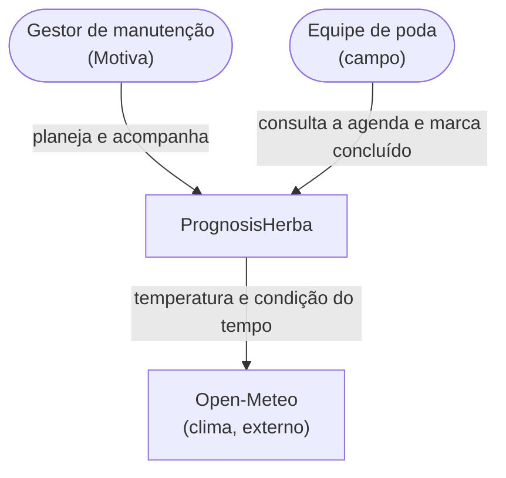
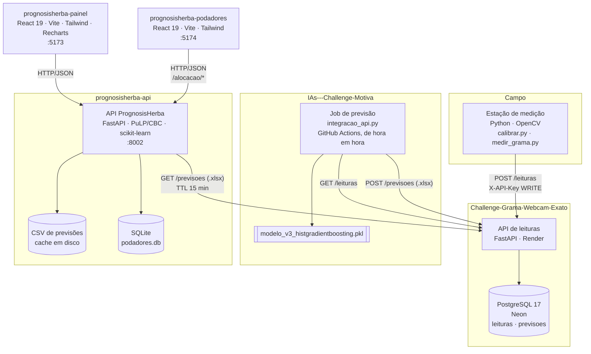
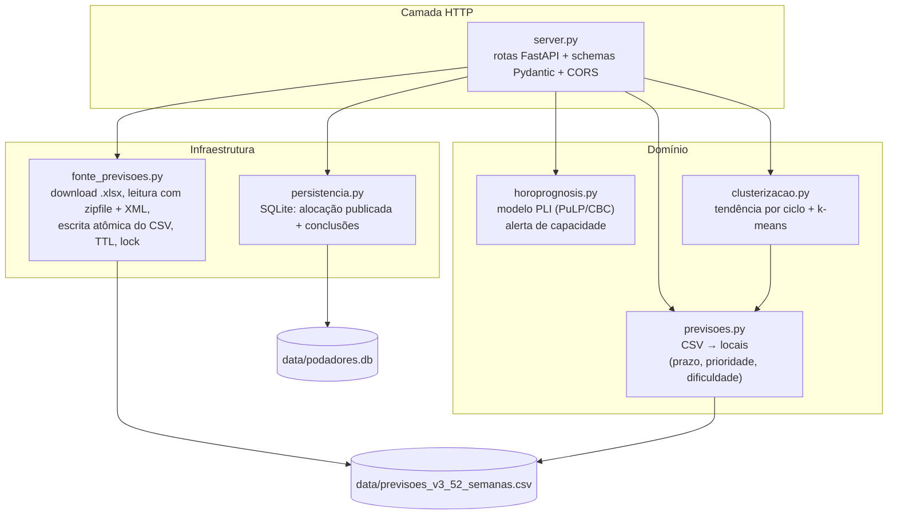
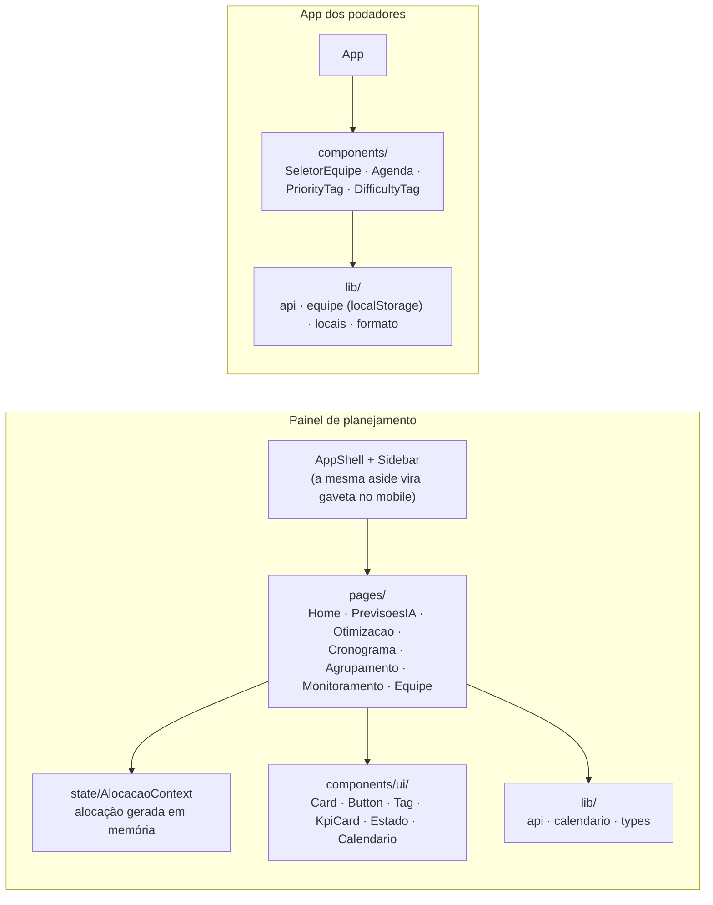
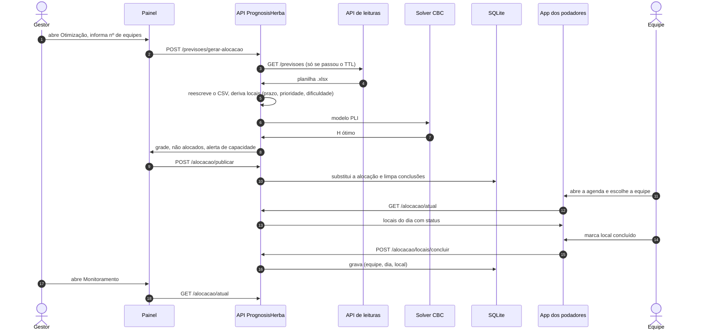
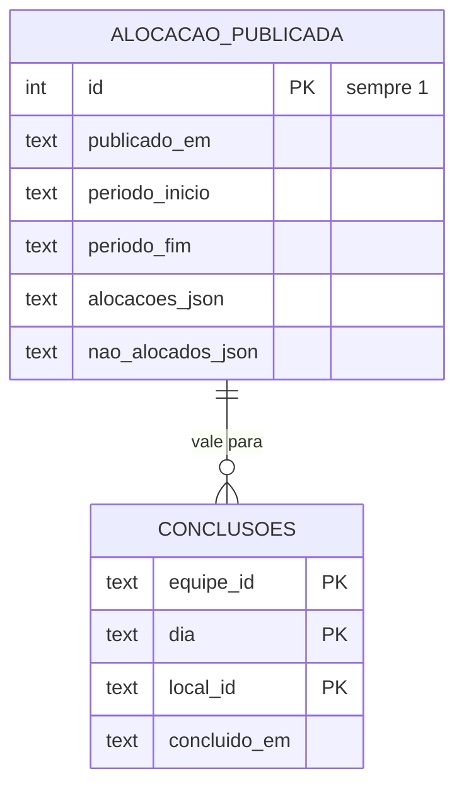
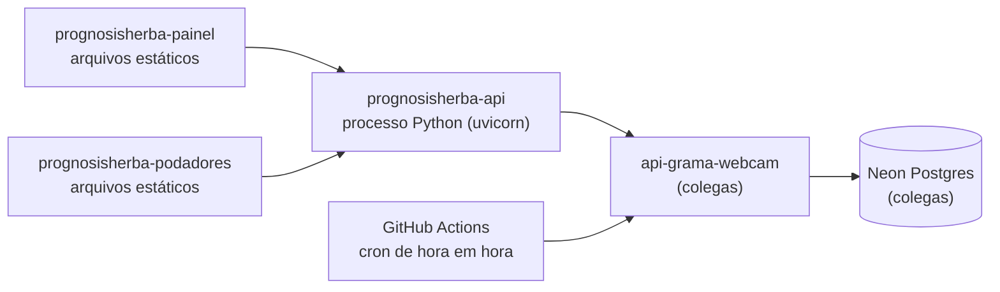

# 02 · Arquitetura de software

A descrição segue o modelo C4: primeiro o sistema no seu contexto, depois
os containers (processos que rodam separados), depois os componentes de
cada container.

## 1. Contexto

Dois tipos de usuário e uma dependência externa. Não há login: o painel é
de uso interno e o app das equipes guarda a equipe escolhida no próprio
aparelho.

## 2. Containers

| Container | Tecnologia | Responsabilidade | Estado |
|---|---|---|---|
| **Estação de medição** | Python, OpenCV, numpy | Captura, segmenta, mede a altura em cm, busca o clima, envia a leitura | `calibration.json` local |
| **API de leituras** | FastAPI, psycopg, PostgreSQL (Neon) | Guarda leituras brutas e serve como cofre das planilhas de previsão. Não calcula nada | Postgres |
| **Job de previsão** | Python, scikit-learn, pandas | Lê as leituras, roda o modelo, gera a planilha `.xlsx` e publica | Nenhum (o modelo é um arquivo) |
| **API PrognosisHerba** | FastAPI, PuLP/CBC, scikit-learn | Ingere a planilha, deriva os locais de poda, roda o solver, agrupa regiões, guarda a alocação publicada | CSV (cache) + SQLite |
| **Painel de planejamento** | React 19, Vite 8, Tailwind 4, Recharts, React Router | Telas de Previsões, Otimização, Cronograma, Agrupamento e Monitoramento | Contexto React (em memória) |
| **App dos podadores** | React 19, Vite 8, Tailwind 4 | Agenda do dia por equipe e marcação de concluído | `localStorage` (equipe escolhida) |

### Fronteiras de responsabilidade

- **A API de leituras só guarda dados brutos.** Previsão e análise ficam
  com quem consome. Por isso o `/previsoes` dela é um cofre de bytes, não
  um endpoint de cálculo.
- **A IA não conhece o solver.** Ela publica alturas previstas e níveis
  de alerta. Quem traduz isso para prioridade, dificuldade e prazo é o
  backend PrognosisHerba (`previsoes.py`).
- **O solver não conhece a IA.** `horoprognosis.py` recebe uma lista de
  locais com `id`, `prioridade`, `dificuldade` e `dataAlvo`. Dá para
  trocar a fonte das previsões sem tocar no modelo.
- **A clusterização não alimenta o solver.** É camada de análise. Se
  alimentasse, o cronograma ficaria refém de um `k` arbitrário.

## 3. Componentes da API PrognosisHerba

Organização em camadas: as rotas só validam e montam a resposta; a regra
de negócio fica em módulos puros, testáveis sem HTTP.

| Módulo | Entrada | Saída | Notas |
|---|---|---|---|
| `fonte_previsoes.py` | Planilha `.xlsx` da API de leituras | CSV reescrito | Sem `GRAMA_API_KEY` fica desligado. Falha de rede mantém o último CSV bom. Escrita atômica (arquivo temporário + rename). `threading.Lock` evita duas sincronizações ao mesmo tempo |
| `previsoes.py` | CSV | `[{id, prioridade, dificuldade, dataAlvo}]` | Primeira semana em que $\hat h \ge L$ vira o prazo |
| `horoprognosis.py` | Lista de locais, nº de equipes, capacidade | Grade equipe × dia, não alocados, alerta | Duas variantes: mês fixo e horizonte completo com prazos |
| `clusterizacao.py` | Séries com `houve_poda` | Grupos rotulados (crítico, atenção, estável) | Rota simulada |
| `persistencia.py` | Alocação publicada, conclusões | Alocação + status | Publicar substitui a anterior e limpa as conclusões |

### API (resumo)

| Método | Rota | Usada por |
|---|---|---|
| `GET` | `/health` | Verificação de saúde da hospedagem |
| `GET` | `/parametros` | Painel: limiar e capacidade, fonte única desses números |
| `GET` | `/previsoes` | Painel: tela de Previsões |
| `POST` | `/previsoes/gerar-alocacao` | Painel: tela de Otimização |
| `POST` | `/gerar-alocacao` | Uso manual: lote informado no corpo, mês fixo |
| `GET` | `/clusterizacao?k=N` | Painel: tela de Agrupamento |
| `POST` | `/alocacao/publicar` | Painel, logo depois do solver |
| `GET` | `/alocacao/atual` | App dos podadores e Monitoramento |
| `POST` | `/alocacao/locais/concluir` | App dos podadores |

Documentação interativa em `/docs` (Swagger) e `/redoc`.

## 4. Componentes dos frontends

Os dois frontends acessam a API por um único módulo `lib/api.ts`, que lê
`VITE_API_BASE_URL` e transforma falha de rede em mensagem legível. Os
tipos da API ficam em `lib/types.ts`, duplicados nos dois projetos (ver
[04 · Repositórios](04-repositorios.md#contratos-entre-os-repositórios)).

## 5. Sequência principal: da previsão à agenda

## 6. Dados e estado

| Onde | O quê | Vida útil |
|---|---|---|
| Postgres (API de leituras) | Leituras das estações; planilhas `.xlsx` de previsão (BYTEA) | Permanente |
| CSV (API PrognosisHerba) | Cópia da aba de 52 semanas da última planilha | Até a próxima sincronização bem-sucedida |
| SQLite (API PrognosisHerba) | Alocação publicada + conclusões | Até a próxima publicação |
| Contexto React (painel) | Alocação recém-gerada | Até recarregar a página |
| `localStorage` (app) | Equipe escolhida no aparelho | Até limpar o navegador |

O CSV faz papel de **cache em disco**: a API de leituras roda em plano
gratuito que hiberna e leva ~50 s para acordar. Sem o arquivo local,
toda visita à tela de Previsões pagaria essa espera, e cairia junto se a
API estivesse fora do ar.

## 7. Deploy

A hospedagem das três aplicações deste projeto está **em definição**: os
serviços que rodavam no Render vão sair do ar. A estação e a IA continuam
nos serviços dos colegas (API de leituras no Render + Neon, job da IA no
GitHub Actions).

O que qualquer hospedagem precisa oferecer:

| Aplicação | Precisa de | Observação |
|---|---|---|
| `prognosisherba-painel` e `prognosisherba-podadores` | Hospedagem de site estático com *rewrite* `/* → /index.html` | O React Router controla as rotas; sem o *rewrite*, recarregar `/previsoes` dá 404. `VITE_API_BASE_URL` é embutida no *build*, então trocar a URL da API exige novo *build* |
| `prognosisherba-api` | Processo Python 3.11+ rodando `uvicorn server:app --host 0.0.0.0 --port $PORT` | O solver CBC vem dentro do pacote `pulp`, não precisa instalar nada no sistema |
| `prognosisherba-api` | **Disco persistente** ou banco externo | O `podadores.db` (SQLite) guarda a alocação publicada. Em hospedagem com disco efêmero, ela se perde a cada reinício; nesse caso, mover a persistência para um Postgres gerenciado |

As variáveis de ambiente de cada repositório estão no `.env.example`
dele.

## 8. Qualidade

| Repositório | Testes | Observações |
|---|---|---|
| API PrognosisHerba | 180 (pytest) | Sem mock do solver nem do banco: o CBC resolve de verdade e o SQLite grava de verdade. A suíte zera `GRAMA_API_KEY`, então nunca toca a rede |
| Painel | 117 (Vitest + Testing Library) | Cobertura mínima de 100% exigida em `vitest.config.ts` |
| App dos podadores | 58 (Vitest + Testing Library) | Mesma regra de 100% |
| Estação + API de leituras | ~190 (pytest) | Contra Postgres real, numa *branch* de teste do Neon |

Lint com `oxlint` nos frontends.

## 9. Decisões de arquitetura

| Decisão | Motivo | Custo aceito |
|---|---|---|
| Solver sobre todo o horizonte, cada local com seu prazo | Otimizar mês a mês criava fronteiras artificiais e distribuía mal as equipes | Problema um pouco maior |
| Prioridade e dificuldade como parâmetros, não índices de $H$ | Elas chegam prontas; como índice, o solver poderia "escolher" uma prioridade errada | Nenhum |
| CSV como cache em disco | Mantém as telas no ar com a API externa hibernando | Dado pode ficar até 15 min atrasado |
| `.xlsx` lido com `zipfile` + `ElementTree` | Evita instalar `openpyxl` ou `pandas` só para ler uma aba | Código de leitura próprio |
| SQLite para a alocação publicada | Único estado do sistema, volume baixo | Exige disco persistente na hospedagem (ver Deploy) |
| App dos podadores sem login | Login em campo atrasa a equipe e não protege nada sensível | Sem rastreabilidade de quem marcou |
| Duas chaves de API (leitura e escrita) na API de leituras | Poucos clientes conhecidos; dispensa provedor de identidade | Chave de escrita compartilhada entre estações |
| Segmentação por cor (HSV) em vez de rede neural | Câmera fixa, alvo consistente; roda em qualquer CPU e é auditável | Sensível a iluminação e a vegetação seca |
| Topografia fixa por região no backend | A IA manda inclinação constante; usar esse valor deixaria todo local "fácil" | Precisa atualizar à mão até a IA mandar o dado real |
