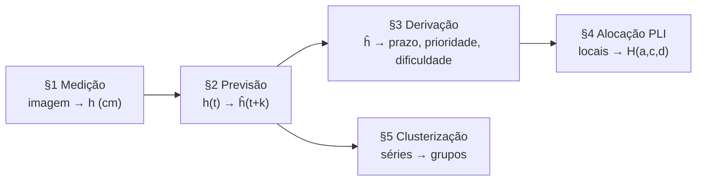

# 03 · Modelo matemático

O sistema encadeia cinco modelos. Cada um entrega ao seguinte uma
grandeza bem definida:

Notação usada em todo o documento:

| Símbolo | Significado |
|---|---|
| $r$ | Região (trecho com estação), $r \in R = \{\text{RA-01}, \dots, \text{RA-04}\}$ |
| $t$ | Semana |
| $h_{r,t}$ | Altura medida da grama, em cm |
| $\hat h_{r,t}$ | Altura prevista pela IA, em cm |
| $L$ | Limiar de poda, em cm |
| $\lceil x \rceil$ | Menor inteiro $\ge x$ |
| $\mathbb{1}[\cdot]$ | Indicadora: 1 se a condição vale, 0 se não |

---

## §1 · Medição da altura por visão computacional

Repositório [`prognosisherba-visao`](https://github.com/Zinorblatant-cpu/prognosisherba-visao):
`calibrar.py`, `medir_grama.py` e `pick.py`.

### 1.1 Calibração (uma vez por câmera)

O operador clica nos dois extremos de um objeto de tamanho conhecido
$\ell_{\text{ref}}$ (em cm) e depois na linha do chão $y_{\text{chão}}$. A escala da imagem é

$$
\rho = \frac{\sqrt{(x_2 - x_1)^2 + (y_2 - y_1)^2}}{\ell_{\text{ref}}} \quad [\text{px/cm}]
$$

### 1.2 Segmentação do verde

Para cada um dos $N_f = 5$ quadros $I_k$, converte-se para HSV e marca-se
o pixel como vegetação quando está dentro da faixa de cor:

$$
M_k(u,v) = \mathbb{1}\big[(35, 40, 40) \le \mathrm{HSV}(I_k(u,v)) \le (85, 255, 255)\big]
$$

Em seguida, abertura e fechamento morfológicos com elemento estruturante
$E$ de $3 \times 3$ removem pontos soltos e fecham buracos:

$$
M'_k = (M_k \circ E) \bullet E
$$

A máscara final é a **mediana temporal** dos cinco quadros, que elimina
ruídos passageiros (sombra, vento, inseto):

$$
\bar M(u,v) = \operatorname{med}_{k=1..5} M'_k(u,v)
$$

### 1.3 Altura por coluna e agregação

São amostradas três colunas $u_j = \lfloor W f_j \rfloor$, com
$f_j \in \{0{,}25;\ 0{,}50;\ 0{,}75\}$ e $W$ a largura do quadro. O topo do
verde em cada coluna é o primeiro pixel marcado de cima para baixo:

$$
y_j^{\text{topo}} = \min\{\, v : \bar M(u_j, v) = 1 \,\}
$$

e a altura em cm é

$$
h_j = \max\!\left(0,\ \frac{y_{\text{chão}} - y_j^{\text{topo}}}{\rho}\right)
$$

A leitura enviada é a **mediana** das colunas válidas, com margem de erro
igual à meia amplitude:

$$
h = \operatorname{med}_j h_j, \qquad \delta = \frac{\max_j h_j - \min_j h_j}{2}
$$

A mediana impede que um galho isolado numa coluna mova a leitura inteira.

### 1.4 Classificação de risco

$$
\text{nível}(h) =
\begin{cases}
\text{AUSENTE} & \text{sem pixel verde} \\
\text{BAIXA} & h \le 3 \\
\text{MÉDIA} & 3 < h \le 7 \\
\text{ALTA} & h > 7
\end{cases}
$$

### 1.5 Grade em cm

A calibração também grava em `calibration.json` uma **grade de pontos**
com passo $s = 0{,}5$ cm. A origem fica no chão: $x = 0$ na borda
esquerda do quadro e altura $0$ na linha do chão, crescendo para cima.
Cada ponto da grade ocupa

$$
q = \rho\, s \quad [\text{px por ponto}]
$$

e o ponto $(i, j)$ da grade corresponde ao pixel

$$
(x, y) = \big(\operatorname{round}(i\,q),\ \operatorname{round}(y_{\text{chão}} - j\,q)\big)
$$

No sentido contrário, qualquer pixel tem uma distância conhecida em cm:

$$
(x, y) \mapsto \left(\frac{x}{\rho},\ \frac{y_{\text{chão}} - y}{\rho}\right)
$$

Na tela de confirmação do `calibrar.py` a grade aparece desenhada e, ao
passar o mouse, aparece a distância do ponto mais próximo (por exemplo,
`x=12,5cm  altura=+3,0cm`).

### 1.6 Grama maior pelo teorema de Pick

A leitura de §1.3 olha só três colunas. Para achar o trecho mais alto do
quadro, a estação mede o **perfil inteiro** da grama, coluna a coluna da
grade.

**Perfil.** São $N = \lfloor (W-1)/q \rfloor + 1$ colunas, em
$x_i = \operatorname{round}(i\,q)$. Em cada uma, o topo do verde (§1.3)
vira uma altura inteira em pontos da grade:

$$
g_i =
\begin{cases}
\operatorname{round}\!\left(\dfrac{y_{\text{chão}} - y_i^{\text{topo}}}{q}\right) & \text{se há verde acima do chão} \\
0 & \text{caso contrário}
\end{cases}
$$

**Faixas.** As colunas são divididas em $K = 8$ faixas verticais, com
limites $\ell_k = \operatorname{round}\big(k(N-1)/K\big)$, $k = 0, \dots, K$. A
faixa $k$ vai da coluna $\ell_k$ à $\ell_{k+1}$.

**Polígonos.** Dentro de uma faixa, cada trecho contínuo de colunas com
$g_i > 0$ vira um polígono $P$ com vértices na grade: os topos
$(i, g_i)$, fechados no chão $(\cdot, 0)$ nas colunas vizinhas. Fechar nas
vizinhas impede que o polígono encoste em si mesmo no chão, porque o
teorema de Pick exige polígono simples.

**Área.** Para um polígono simples com vértices em pontos da grade, o
**teorema de Pick** dá a área contando pontos:

$$
A(P) = I + \frac{B}{2} - 1 \quad [\text{pontos}^2]
$$

- $I$ = pontos da grade estritamente dentro de $P$, contados por
  *ray casting* com aritmética inteira exata;
- $B$ = pontos sobre a borda. Uma aresta $(\Delta x, \Delta y)$ passa
  por $\gcd(|\Delta x|, |\Delta y|)$ pontos sem contar o final, logo
  $B = \sum_{\text{arestas}} \gcd(|\Delta x|, |\Delta y|)$.

Polígonos degenerados (todos os vértices numa reta) têm área 0.

**Altura média da faixa.** Área dividida pela largura, convertida para cm:

$$
\bar g_k = \frac{\sum_{P \subset \text{faixa } k} A(P)}{\ell_{k+1} - \ell_k} \cdot s \quad [\text{cm}]
$$

Como os vértices estão na grade, o resultado de Pick é igual ao da
fórmula do laço (*shoelace*) e ao da regra dos trapézios sobre o perfil,
$\sum_i \tfrac{g_i + g_{i+1}}{2}$; os testes de `pick.py` conferem essa
igualdade. Na prática, $\bar g_k$ aproxima a altura média
$\frac{1}{L}\int h(x)\,dx$ da faixa, amostrada a cada 0,5 cm.

**Grama maior.** É a faixa de maior altura média:

$$
k^{*} = \arg\max_k \bar g_k, \qquad \text{reportada só se } \bar g_{k^{*}} > 0
$$

Ela aparece no terminal e na imagem de depuração
(`debug/ultima_medicao.png`). **O valor enviado à API continua sendo a
mediana das três colunas** (§1.3); a grama maior é informação adicional
para quem opera a estação.

| | Mediana de 3 colunas (§1.3) | Grama maior por Pick (§1.6) |
|---|---|---|
| Amostra | 3 colunas fixas | Todas as colunas da grade (a cada 0,5 cm) |
| Mede | Altura típica do quadro | Altura média do trecho mais alto |
| Robustez | Ignora um galho isolado | Média por faixa suaviza picos de uma coluna |
| Vai para a API | Sim | Não |

---

## §2 · Previsão do crescimento (IA)

Repositório da IA: notebook `main_v3.ipynb` e `integracao_api.py`.

### 2.1 Variável-alvo e detecção de poda

O modelo não prevê a altura diretamente, e sim o **incremento** entre
leituras consecutivas:

$$
\Delta h_{r,t} = h_{r,t} - h_{r,t-1}
$$

Uma queda de altura indica que houve poda:

$$
\text{poda}_{r,t} = \mathbb{1}[\Delta h_{r,t} < 0]
$$

Só as semanas de crescimento ($\text{poda}_{r,t} = 0$) entram no treino.
Cada ciclo entre duas podas recebe um número
$\text{ciclo}_{r,t} = \sum_{s \le t} \text{poda}_{r,s}$, usado na validação.

### 2.2 Variáveis de entrada

$$
\mathbf{x}_{r,t} = \big(\, GD_{t},\ m_t,\ T_t,\ \tau_{r,t},\ r,\ \kappa_t \,\big)
$$

| Variável | Significado | Tipo |
|---|---|---|
| $GD_t$ | Graus-dia | Numérica |
| $m_t$ | Mês (sazonalidade) | Numérica |
| $T_t$ | Temperatura média (°C) | Numérica |
| $\tau_{r,t}$ | Dias desde a última poda | Numérica |
| $r$ | Região | Categórica nativa |
| $\kappa_t$ | Condição do tempo | Categórica nativa |

### 2.3 Modelo: *gradient boosting* de histogramas

Um único modelo para todas as regiões (*pooled*), em que a região é uma
variável. É uma soma de $M$ árvores rasas, cada uma treinada para corrigir
o erro acumulado das anteriores:

$$
F_M(\mathbf{x}) = F_0 + \nu \sum_{m=1}^{M} f_m(\mathbf{x}),
\qquad
f_m = \arg\min_{f}\ \sum_{i} \big(g_i^{(m)} - f(\mathbf{x}_i)\big)^2 + \lambda\, \Omega(f)
$$

onde $g_i^{(m)} = \Delta h_i - F_{m-1}(\mathbf{x}_i)$ é o resíduo (gradiente
negativo da perda quadrática) e $\Omega$ penaliza os pesos das folhas.
Hiperparâmetros:

| $M$ (árvores) | profundidade máxima | $\nu$ (taxa de aprendizado) | $\lambda$ (L2) |
|---|---|---|---|
| 200 | 4 | 0,05 | 1,0 |

Valores conservadores porque o conjunto é pequeno (173 semanas de crescimento).

### 2.4 Simulação das semanas futuras

As variáveis climáticas futuras não são conhecidas; usa-se a
**climatologia mensal** do histórico:

$$
\widehat{GD}(m) = \overline{GD}_{\,\text{mês}=m}, \qquad
\hat T(m) = \overline{T}_{\,\text{mês}=m}, \qquad
\hat\kappa(m) = \operatorname{moda}(\kappa)_{\,\text{mês}=m}
$$

A altura é propagada semana a semana, sem permitir decrescimento:

$$
\hat h_{r,t+1} = \hat h_{r,t} + \max\!\big(0,\ F_M(\hat{\mathbf{x}}_{r,t+1})\big)
$$

Na simulação de 52 semanas, quando $\hat h$ chega a 10 cm a IA registra
uma poda (`houve_poda`) e a altura volta à altura média pós-poda da
região, $\bar h^{\text{base}}_r$. Por isso a curva prevista é **serrilhada**.

Nível de alerta enviado em cada semana:

$$
\text{alerta}(\hat h) =
\begin{cases}
\text{baixo} & \hat h < 7 \\
\text{médio} & 7 \le \hat h < 10 \\
\text{alto} & 10 \le \hat h < 20 \\
\text{crítico} & \hat h \ge 20
\end{cases}
$$

### 2.5 Validação

O **último ciclo de poda de cada região** fica fora do treino
(*holdout* temporal). O erro é o MAE do incremento semanal:

$$
\mathrm{MAE}_r = \frac{1}{n_r} \sum_{t \in \text{teste}_r} \big|\Delta h_{r,t} - F_M(\mathbf{x}_{r,t})\big|
$$

| Região | $n$ | MAE (cm) |
|---|---|---|
| RA-01 | 8 | 0,187 |
| RA-02 | 1 | 0,252 |
| RA-03 | 7 | 0,207 |
| RA-04 | 8 | 0,173 |
| **Média** | | **0,205** |

Nas 24 semanas de teste, o maior erro absoluto foi de **0,505 cm**
($\max_t |\Delta h_{r,t} - F_M(\mathbf{x}_{r,t})|$). O treino da
validação usa 149 semanas; depois dela, o modelo final é retreinado com
100% dos dados.

Limitações registradas pela própria IA: amostra pequena; $GD$ e $T$ têm
correlação de Pearson 1,00 (informação duplicada); a variável mais
correlacionada com $\Delta h$ é $\tau$ (0,53).

---

## §3 · Da previsão aos locais de poda

Backend PrognosisHerba: `previsoes.py`.

### 3.1 Prazo

Para cada região, o prazo é a primeira semana em que a previsão cruza o
limiar:

$$
t^{*}_r = \min\{\, t : \hat h_{r,t} \ge L \,\}, \qquad L = 9{,}0 \text{ cm}
$$

O conjunto de locais a podar é

$$
A = \{\, r \in R : t^{*}_r \text{ existe no horizonte} \,\},
\qquad \text{prazo}(a) = \text{data}(t^{*}_a)
$$

As regiões sem $t^{*}$ voltam na resposta como `semAlertaNoHorizonte`.

> **Por que 9,0 e não 10 cm.** A previsão de 52 semanas já embute as
> podas: a curva serrilhada volta à base antes de passar de ~9,9 cm. Com
> $L = 10$ nenhuma região cruzaria e não haveria o que otimizar. $L$ é
> parâmetro da requisição e aparece em `GET /parametros`.

### 3.2 Prioridade e dificuldade

A prioridade combina a **área de risco** do trecho, $\varphi_a \in \{\text{baixo}, \text{médio}, \text{alto}\}$,
com o **alerta da IA** na semana do prazo, $\alpha_a = \text{alerta}\big(\hat h_{a,\,t^{*}_a}\big)$:

$$
\text{prioridade}(a) =
\begin{cases}
\text{alta} & \alpha_a \in \{\text{alto}, \text{crítico}\} \\
\text{baixa} & \varphi_a = \text{baixo} \\
\text{média} & \varphi_a = \text{médio} \text{ ou desconhecido} \\
\text{alta} & \varphi_a = \text{alto}
\end{cases}
$$

(a primeira linha tem precedência). Com os dados atuais o resultado é
RA-01 baixa, RA-02 e RA-03 média, RA-04 alta.

> **Por que não usar só o alerta da IA.** Pelas faixas da IA (§2.4),
> toda altura em $[7, 10)$ é "médio". Como $L = 9$ e a curva prevista
> nunca passa de 9,9 cm, as quatro regiões cruzavam o limiar com alerta
> "médio" e todo local recebia $p_a = 2$: o peso de prioridade não
> diferenciava ninguém. A área de risco diz o quanto aquele trecho é
> perigoso; o alerta continua valendo como urgência e sobe o local para
> "alta" quando a IA prevê altura de 10 cm ou mais no prazo.

A dificuldade vem da inclinação do terreno $\theta_a$ (graus):

$$
\text{dificuldade}(a) =
\begin{cases}
\text{fácil} & \theta_a \le 7^\circ \\
\text{média} & 7^\circ < \theta_a \le 15^\circ \\
\text{difícil} & \theta_a > 15^\circ
\end{cases}
$$

Com as inclinações atuais (4,5°; 9,2°; 11,8°; 22,3°) as três faixas
aparecem.

---

## §4 · Alocação das equipes (HoroHerba): programação linear inteira

Backend PrognosisHerba: `horoprognosis.py`, função
`rodar_modelo_horoprognosis_com_prazos`. Resolvido com PuLP + CBC.

### 4.1 Conjuntos

| Conjunto | Significado |
|---|---|
| $A$ | Locais de poda (§3) |
| $C = \{1, \dots, n_C\}$ | Equipes, intercambiáveis entre si |
| $D$ | Dias úteis (segunda a sexta) entre $\min_a \text{prazo}(a)$ e $\max_a \text{prazo}(a)$ |
| $V \subseteq A \times C \times D$ | Combinações permitidas: $V = \{(a,c,d) : d \le \text{prazo}(a)\}$ |

### 4.2 Parâmetros

| Parâmetro | Significado | Valor |
|---|---|---|
| $p_a$ | Peso da prioridade | baixa 1 · média 2 · alta 3 |
| $w_a$ | Custo de capacidade da dificuldade | fácil 1 · média 1,5 · difícil 3 |
| $K$ | Capacidade de uma equipe por dia | 3 |
| $W = \sum_{a \in A} w_a$ | Demanda total do lote | calculado |

Com $K = 3$, uma equipe faz por dia 3 locais fáceis, ou 2 médios, ou 1
difícil, ou qualquer mistura cuja soma de custos não passe de 3.

### 4.3 Variáveis de decisão

$$
H_{a,c,d} \in \{0, 1\} \quad \forall (a,c,d) \in V
$$

$H_{a,c,d} = 1$ significa que a equipe $c$ poda o local $a$ no dia $d$.
Há também duas variáveis contínuas auxiliares, $z^{\max}, z^{\min} \ge 0$,
para o balanceamento de carga.

Prioridade e dificuldade **não são índices** de $H$: chegam prontas com
cada local. Como índice, o solver poderia atribuir a um local uma
prioridade que ele não tem.

### 4.4 Formulação completa

$$
\max \quad Z = \sum_{(a,c,d) \in V} p_a\, H_{a,c,d} \;-\; \varepsilon_{\max}\, z^{\max} \;+\; \varepsilon_{\min}\, z^{\min}
$$

sujeito a

$$
\begin{aligned}
&\text{(R1) cada local no máximo uma vez} && \sum_{(c,d) :\, (a,c,d) \in V} H_{a,c,d} \le 1 && \forall a \in A \\[4pt]
&\text{(R2) capacidade diária} && \sum_{a :\, (a,c,d) \in V} w_a\, H_{a,c,d} \le K && \forall c \in C,\ d \in D \\[4pt]
&\text{(R3) prazo} && H_{a,c,d} = 0 && \forall d > \text{prazo}(a) \\[4pt]
&\text{(R4) teto de carga} && \sum_{(a,d) :\, (a,c,d) \in V} w_a\, H_{a,c,d} \le z^{\max} && \forall c \in C \\[4pt]
&\text{(R4) piso de carga} && \sum_{(a,d) :\, (a,c,d) \in V} w_a\, H_{a,c,d} \ge z^{\min} && \forall c \in C \\[4pt]
&\text{domínio} && H_{a,c,d} \in \{0,1\},\quad z^{\max}, z^{\min} \ge 0
\end{aligned}
$$

com

$$
\varepsilon_{\max} = \frac{1}{2(W+1)}, \qquad
\varepsilon_{\min} = \frac{\varepsilon_{\max}}{2(W+1)}
$$

Leitura de cada peça:

- **Objetivo:** atender o máximo de prioridade. Quando falta capacidade,
  os locais de prioridade alta entram primeiro.
- **R1** é $\le 1$ e não $= 1$: se não houver capacidade para todos, o
  modelo continua viável e deixa de fora os de menor prioridade, que
  voltam como `naoAlocados`.
- **R3** não vira restrição no solver: as combinações depois do prazo
  simplesmente não são criadas como variável ($V$). Fica mais leve do que
  criar a variável e forçá-la a zero.
- **R4** existe porque as equipes são intercambiáveis: sem ele, concentrar
  tudo em duas equipes e deixar duas paradas tem o mesmo valor de
  objetivo que distribuir. Isso foi observado na prática.

### 4.5 Por que os termos de balanceamento nunca mudam quais locais entram

A ordem de preferência do modelo é lexicográfica:
**prioridade atendida ≻ menor carga máxima ≻ maior carga mínima**.

*Primeiro nível.* Os pesos $p_a$ são inteiros, então duas soluções com
prioridades diferentes diferem em pelo menos 1 no primeiro termo. A carga
de uma equipe nunca passa da demanda total, logo $0 \le z^{\min} \le z^{\max} \le W$ e

$$
\big| -\varepsilon_{\max} z^{\max} + \varepsilon_{\min} z^{\min} \big|
\le \varepsilon_{\max} W = \frac{W}{2(W+1)} < \frac{1}{2}
$$

A perturbação total é menor que $\tfrac12$, e portanto menor que
qualquer ganho de prioridade.

*Segundo nível.* Os custos $w_a \in \{1;\ 1{,}5;\ 3\}$ são múltiplos de
$0{,}5$, então duas cargas máximas diferentes diferem em pelo menos
$0{,}5$, o que vale pelo menos $0{,}5\,\varepsilon_{\max}$ no objetivo. Já o
termo de piso vale no máximo

$$
\varepsilon_{\min} W = \varepsilon_{\max}\frac{W}{2(W+1)} < \frac{\varepsilon_{\max}}{2}
$$

Assim, o piso só desempata soluções com a mesma prioridade e a mesma
carga máxima. $\blacksquare$

### 4.6 Alerta de capacidade insuficiente

Calculado fora do solver, como diagnóstico agregado:

$$
\text{Cap} = |C| \cdot |D| \cdot K, \qquad \text{Dem} = W
$$

Se $\text{Dem} > \text{Cap}$:

$$
\text{déficit} = \text{Dem} - \text{Cap}, \qquad
\text{equipes-dia} = \left\lceil \frac{\text{déficit}}{K} \right\rceil, \qquad
\text{equipes extras} = \left\lceil \frac{\text{equipes-dia}}{|D|} \right\rceil
$$

*Exemplo:* 4 equipes × 21 dias × 3 = 252 pontos de capacidade. Uma
demanda de 300 deixa déficit de 48 → $\lceil 48/3 \rceil = 16$ equipes-dia →
$\lceil 16/21 \rceil = 1$ equipe extra.

É uma condição **suficiente** para faltar capacidade, não necessária:
com prazos diferentes, um local pode ficar de fora mesmo com
$\text{Dem} \le \text{Cap}$, porque a capacidade dos dias depois do prazo
dele não serve para ele. A lista `naoAlocados` é que reflete o resultado
exato.

### 4.7 Folga no cronograma

Para cada local alocado no dia $d_a$, o painel mostra

$$
\text{folga}(a) = \text{prazo}(a) - d_a \quad [\text{dias}]
$$

Por R3, $\text{folga}(a) \ge 0$ em toda alocação gerada pelo solver.

### 4.8 Tamanho e complexidade

$$
|V| \le |A| \cdot |C| \cdot |D| \ \text{variáveis binárias}, \qquad
|A| + |C|\,|D| + 2|C| \ \text{restrições}
$$

Exemplo: 50 locais × 4 equipes × 21 dias = 4.200 binárias. O problema
generaliza a mochila múltipla (cada par equipe-dia é uma mochila de
capacidade $K$), que é NP-difícil. O CBC resolve por *branch-and-cut*:
relaxação linear, planos de corte e ramificação. Nos tamanhos do
protótipo a solução ótima sai em frações de segundo.

O tamanho cresce com a **dispersão dos prazos** e com $|A|$, não com o
horizonte da previsão: $D$ vai do prazo mais próximo ao mais distante.

### 4.9 Variante de mês fixo

`rodar_modelo_horoprognosis` (rota `POST /gerar-alocacao`) usa o mesmo
modelo com $D$ = dias úteis de um mês informado e $V = A \times C \times D$
(sem R3). Serve para testar um lote montado à mão.

---

## §5 · Agrupamento de regiões (k-means)

Backend PrognosisHerba: `clusterizacao.py`. Camada de análise, **não
alimenta o solver**.

### 5.1 Tendência dentro do ciclo corrente

A série prevista é serrilhada. Uma reta sobre a série inteira daria
tendência negativa para uma região que acabou de ser podada. Por isso a
série é cortada nas podas e a inclinação é medida só no ciclo atual
$\mathcal{C}$ (desde a última poda), por mínimos quadrados:

$$
\beta_r = \frac{\sum_{i \in \mathcal{C}} (i - \bar i)(\hat h_i - \bar h)}{\sum_{i \in \mathcal{C}} (i - \bar i)^2}
\quad [\text{cm/semana}]
$$

Com menos de 3 pontos no ciclo atual, usa-se a média das inclinações
dos ciclos completos anteriores. Sem nenhum ciclo utilizável,
$\beta_r = 0$.

### 5.2 Variáveis e padronização

$$
\mathbf{v}_r = \big(\, \text{onehot}^{-1}(\text{rota}_r),\ \hat h_{r,\text{último}},\ \beta_r \,\big)
$$

A rota entra em *one-hot* sem a primeira categoria; com todas as
categorias, as colunas de rota dominariam a distância, e hoje a rota é
**simulada**. Colunas constantes são descartadas e as restantes são
padronizadas:

$$
z_{r,j} = \frac{v_{r,j} - \mu_j}{\sigma_j}
$$

### 5.3 k-means

$$
\min_{S_1, \dots, S_k} \sum_{i=1}^{k} \sum_{r \in S_i} \lVert \mathbf{z}_r - \boldsymbol{\mu}_i \rVert^2,
\qquad k = \max\!\Big(1,\ \min\big(4,\ \lfloor |R| / 2 \rfloor\big)\Big)
$$

(ou o $k$ informado em `?k=`, limitado ao número de regiões). Semente
fixa (`random_state = 42`) e 10 inicializações. Os grupos são renumerados
da maior para a menor altura média, porque o rótulo cru do k-means muda
entre execuções.

### 5.4 Rótulo de urgência

Com a altura média $\bar h_i$ e a tendência média $\bar\beta_i$ do grupo,
estima-se quantas semanas faltam para o limiar:

$$
s_i = \frac{L - \bar h_i}{\bar\beta_i}
$$

$$
\text{rótulo}_i =
\begin{cases}
\text{acima do limiar} & s_i \le 0,\ \text{ou } \bar\beta_i \le 0 \text{ e } \bar h_i \ge L \\
\text{crítico} & 0 < s_i \le 2 \\
\text{atenção} & 2 < s_i \le 6 \\
\text{estável} & s_i > 6,\ \text{ou } \bar\beta_i \le 0 \text{ e } \bar h_i < L
\end{cases}
$$

As faixas de 2 e 6 semanas vêm do ciclo de poda observado (~6 semanas
entre cortes): "crítico" não espera a próxima janela, "atenção" cabe no
ciclo atual.

---

## Possíveis extensões do modelo

- **Disponibilidade por equipe e feriados:** restrição
  $H_{a,c,d} = 0$ quando a equipe $c$ não trabalha no dia $d$, ou
  remover os feriados de $D$.
- **Deslocamento:** com as rotas reais, somar ao custo $w_a$ um termo de
  distância entre locais do mesmo dia (vira um problema de roteamento).
- **Incerteza da previsão:** antecipar o prazo usando a margem de erro,
  por exemplo $t^{*}_r = \min\{t : \hat h_{r,t} + \mathrm{MAE}\cdot(t - t_0) \ge L\}$.
- **Penalidade por atraso** em vez de prazo rígido, se a operação aceitar
  podar depois do prazo com custo.
