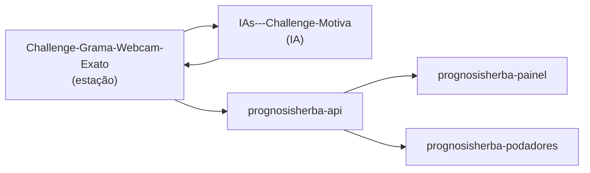

# 04 · Repositórios

O projeto era um monorepo (`PrognosisHerba-front-end`, que apesar do nome
tinha o backend e os dois frontends). Agora cada aplicação tem o seu
repositório, todos com o prefixo `prognosisherba-` seguido do papel:

| Repositório | Conteúdo | Testes |
|---|---|---|
| [**prognosisherba-api**](https://github.com/Zinorblatant-cpu/prognosisherba-api) | FastAPI, solver HoroHerba (PuLP/CBC), derivação das previsões, clusterização, persistência, `MODELO_MATEMATICO.md` | 180 (pytest) |
| [**prognosisherba-painel**](https://github.com/Zinorblatant-cpu/prognosisherba-painel) | Painel de planejamento: Previsões, Otimização, Cronograma, Agrupamento, Monitoramento, página da equipe e vídeo da landing | 117 (Vitest), cobertura 100% |
| [**prognosisherba-podadores**](https://github.com/Zinorblatant-cpu/prognosisherba-podadores) | App das equipes em campo (agenda do dia, marcar concluído) | 58 (Vitest), cobertura 100% |
| [**prognosisherba-docs**](https://github.com/Zinorblatant-cpu/prognosisherba-docs) | Esta documentação e a apresentação | — |

Os dois repositórios dos colegas continuam onde estão:

| Repositório | Papel | Nome sugerido no mesmo padrão |
|---|---|---|
| [Challenge-Grama-Webcam-Exato](https://github.com/carrerigcg/Challenge-Grama-Webcam-Exato) | Estação de medição + API de leituras | `prognosisherba-estacao` |
| [IAs---Challenge-Motiva](https://github.com/Felipek06/IAs---Challenge-Motiva) | IA de crescimento | `prognosisherba-ia` |

Renomear é decisão de cada dono. O GitHub redireciona a URL antiga
depois de um rename.



A seta da IA para a estação existe porque a IA publica a planilha de
previsões na API de leituras, e é de lá que a `prognosisherba-api` a baixa.

## Como a separação foi feita

Cada pasta do monorepo foi extraída com `git subtree split`, que preserva
os commits que tocaram aquela pasta e põe o conteúdo na raiz. Depois,
cada repositório recebeu:

- README próprio, com links para os outros;
- GitHub Actions rodando os testes a cada push (pytest na API; lint,
  testes com cobertura e build nos frontends);
- `.env.example` no lugar do `.env` versionado;
- caminhos `backend/` trocados pela raiz.

O monorepo tinha um único commit, então o histórico dos repositórios
novos começa nele. O histórico anterior (23 commits) está num clone
local antigo, em `prognosisherba/horoprognosis`.

## Por que não dividir mais

- **Solver como biblioteca separada** (`horoherba`): só a API usa o
  solver. Um pacote à parte exigiria versionar e publicar sem nenhum
  segundo consumidor. Vale quando outro projeto (o CronoManeger, por
  exemplo) quiser o mesmo motor.
- **Pacote de tipos compartilhado** entre painel e podadores: os dois só
  compartilham os tipos de `/alocacao/*`. Gerar os tipos a partir do
  OpenAPI (abaixo) resolve sem um quarto pacote.

## Contratos entre os repositórios

O que antes era "mesma pasta" agora é contrato. Uma mudança num destes
pontos quebra outro repositório:

| Produtor → consumidor | Contrato | Onde está definido |
|---|---|---|
| estação → API de leituras | `POST /leituras` com `regiao`, `altura_cm`, `nivel_risco`, `temperatura_c`, `clima` | `api/main.py` da estação |
| IA → API de leituras → `prognosisherba-api` | Planilha `.xlsx` com a aba `previsao_52_semanas_podas` e as colunas `data`, `altura_prevista_cm`, `nivel_alerta`, `houve_poda`, `id_regiao` | `fonte_previsoes.py` (`ABA_PREVISAO`, `COLUNAS_CSV`) |
| `prognosisherba-api` → painel e podadores | Rotas e schemas JSON | `server.py` (Pydantic), publicado em `/openapi.json` |
| `prognosisherba-api` → podadores | `/alocacao/atual` e `/alocacao/locais/concluir` | `server.py` e `src/lib/types.ts` do app |

Recomendações:

1. **O OpenAPI da API é a fonte da verdade.** Em vez de manter
   `src/lib/types.ts` à mão nos dois frontends, gere os tipos com
   `npx openapi-typescript <url-da-api>/openapi.json -o src/lib/api-schema.ts`.
2. **Versione a API com tags** (`v1.0.0`, `v1.1.0`…). Mudança que remove
   ou renomeia campo é versão maior, e os frontends precisam ser
   atualizados junto.
3. **Combine com o autor da IA** que o nome da aba e das colunas da
   planilha é contrato. Se a aba mudar de nome, a ingestão falha e a API
   continua com o último CSV sem ninguém perceber. Um teste no
   repositório da IA validando a planilha gerada evita isso.

## Rodando tudo localmente

```
03-PrognosisHerba/
├── prognosisherba-api/        uvicorn server:app --port 8002 --reload
├── prognosisherba-painel/     npm run dev   → http://localhost:5173
├── prognosisherba-podadores/  npm run dev   → http://localhost:5174
└── prognosisherba-docs/
```

Suba a API primeiro: os dois frontends só mostram dados com ela no ar.

## Pendências

- **Hospedagem.** Os serviços do Render vão sair do ar. Os requisitos de
  cada aplicação estão em [Arquitetura › Deploy](02-arquitetura.md#7-deploy).
- **Repositório antigo.** `PrognosisHerba-front-end` pode ser arquivado
  (*Settings → Archive*) para não ser confundido com os novos.
- **CORS.** A API aceita qualquer origem (`allow_origins=["*"]`). Quando
  as URLs dos frontends estiverem definidas, vale restringir a elas.
